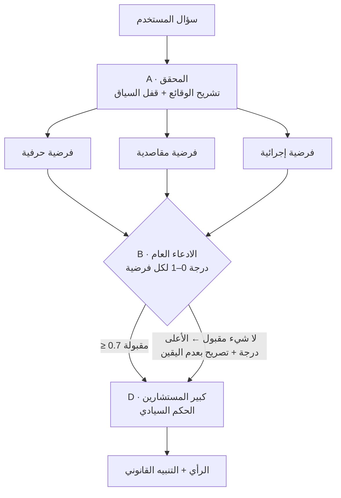

# حَكَم (Hakam) | Sovereign Legal Intelligence ⚖️

[](https://youtu.be/Xa93QZqtFvk)

> **اضغط على الصورة لمشاهدة فيديو الشرح التفصيلي للمشروع** 👆

**منظومة ذكاء اصطناعي قانوني متعددة الوكلاء (Multi-Agent) بالعربية، للتحليل الجنائي للنصوص، والتنقيب عن النوايا، والتقاضي الصوري قبل إصدار الرأي.**

> **تعريف المستودع:** "حَكَم" محكمة صورية رقمية مفتوحة المصدر تجيب عن الأسئلة القانونية بالعربية. لا تكتفي بإجابة واحدة، بل تفكّك الوقائع، وتبني ثلاث فرضيات مستقلة (حرفية، مقاصدية، إجرائية)، ثم يهاجمها "ادعاء عام" آلي ويمنح كل منها درجة، ولا يدخل في الرأي النهائي إلا ما اجتاز حد القبول. يأتي المشروع في صورتين: **تطبيق ويب** (Flask + OpenAI) بواجهة عربية وأرشيف للقضايا، و**مهارة AHLA** تنقل البروتوكول نفسه إلى Claude أو ChatGPT أو أي وكيل ذكاء اصطناعي.
>
> *Hakam is an open-source Arabic legal-reasoning engine: a multi-agent "moot court" that deconstructs facts, generates literal, purposive and procedural hypotheses, scores them with an adversarial verifier, and synthesizes a balanced opinion. Ships as a Flask web app and as the agent-agnostic AHLA skill.*

> **المصدر والإسناد:** هذا المستودع تفرّع (fork) من مشروع [Pythonation/ai-legal-agent-arabic](https://github.com/Pythonation/ai-legal-agent-arabic) لمجتمع بايثون العربي (Python Arabic Community)، صاحب فكرة "حَكَم" وبروتوكول Hakam Kernel. المستودع الأصلي لم يتضمن وحدات `agents/` و`pipeline/` والواجهة، فأُعيد بناؤها هنا، وأضيفت مهارة AHLA والتوثيق والأمثلة.

**لمن هذا المشروع؟** الباحثون القانونيون، والمحامون الذين يريدون مسودة تحليل أولية منظمة، ومطورو تطبيقات الذكاء الاصطناعي القانوني بالعربية، والأفراد الذين يريدون فهم موقفهم قبل استشارة محامٍ.

      

---

## ⬇️ التنزيل — الإصدار 1.0.0

| النسخة | الملف | التشغيل |
|---|---|---|
| 🖥️ **سطح المكتب — مثبّت** | `Hakam-Setup-1.0.0.exe` | ثبّت ثم افتح حَكَم من قائمة ابدأ ([الدليل](docs/DESKTOP.md)) |
| 💼 **سطح المكتب — محمولة** | `Hakam-1.0.0-portable.exe` | شغّل مباشرة بلا تثبيت |
| 🌐 **الويب — أي استضافة** | `hakam-web-1.0.0.zip` | Docker، Render، Heroku، cPanel، VPS… ([الدليل](docs/DEPLOYMENT.md)) |

**[← صفحة الإصدارات](https://github.com/bahattab/ai-legal-agent-arabic/releases/latest)** · كل النسخ تدعم **أي مزود ذكاء اصطناعي** من صفحة الإعدادات ([الدليل](docs/PROVIDERS.md)).

---

## المحتويات
- [نظرة عامة](#-نظرة-عامة)
- [كيف يعمل](#-كيف-يعمل-hakam-kernel-v60)
- [المميزات](#-المميزات)
- [التثبيت والتشغيل](#️-التثبيت-والتشغيل)
- [مزودو الذكاء الاصطناعي](#-مزودو-الذكاء-الاصطناعي)
- [طريقة الاستخدام والأمثلة](#-طريقة-الاستخدام)
- [الإعدادات](#️-الإعدادات)
- [واجهة البرمجة (API)](#-واجهة-البرمجة-api)
- [هيكلية المشروع](#️-هيكلية-المشروع)
- [مهارة الوكلاء (Agent Skill)](#-مهارة-الوكلاء-agent-skill)
- [الاختبارات](#-الاختبارات)
- [خارطة الطريق](#️-خارطة-الطريق)
- [إخلاء المسؤولية](#️-إخلاء-مسؤولية)

---

## 🌟 نظرة عامة

"حَكَم" ليس بوت دردشة، بل **محكمة صورية رقمية** تعمل في الخلفية: تفكّك سؤال المستخدم، وتعرضه على ثلاثة مسارات تفكير متوازية (حرفي، مقاصدي، إجرائي)، ثم تُخضع كل فرضية لمداولة صارمة يتولاها "ادعاء عام" مستقل، ولا يصل إلى الرأي النهائي إلا ما اجتاز حد القبول.

النتيجة رأي متوازن يعالج الثغرات صراحة، مع إمكانية الاطلاع على "مراحل التفكير" كاملة: التحليل، والفرضيات المقبولة والمرفوضة، ودرجة كل منها.

## 🧠 كيف يعمل (Hakam Kernel v6.0)



| المرحلة | الوكيل | النموذج الافتراضي | المخرج |
|---|---|---|---|
| **A** Forensic Deconstruction + Context Lock | المحقق (`agents/analyzer.py`) | `gpt-5.2` | الوقائع، الأطراف، النوايا، النظام الحاكم، بذور الفرضيات |
| **B1** Multi-Path Reasoning | 3 مولّدات متوازية (`agents/hypothesis.py`) | `o4-mini` | فرضية حرفية + مقاصدية + إجرائية |
| **B2** Internal Moot Court | الادعاء العام (`agents/verifier.py`) | `gpt-5-mini` | `score`, `issues`, `strengths`, `recommendation` لكل فرضية |
| **D** Sovereign Verdict | كبير المستشارين (`agents/synthesizer.py`) | `gpt-5.2` | الرأي النهائي + التنبيه |

تفصيل أعمق في [`docs/ARCHITECTURE.md`](docs/ARCHITECTURE.md).

## 🚀 المميزات
- **معمارية متعددة الوكلاء** مع تنفيذ متوازٍ (`asyncio.gather`) للفرضيات والمداولة.
- **بوابة تحقق قابلة للضبط** (`HAKAM_VERIFICATION_THRESHOLD`، الافتراضي 0.7) مع مسار احتياطي آمن عند رفض كل الفرضيات.
- **واجهة عربية RTL** داكنة/ذهبية بخط Tajawal، متجاوبة مع الجوال، تعرض مراحل التفكير ودرجات الفرضيات.
- **أرشيف قضايا محلي** في SQLite مع حفظ كامل مراحل المعالجة لكل رد.
- **أي مزود ذكاء اصطناعي**: OpenAI، Claude، Gemini، OpenRouter، DeepSeek، Groq، Mistral، xAI، Together، Ollama، LM Studio، أو أي خادم متوافق مع OpenAI — ونموذج مستقل لكل وكيل، من صفحة إعدادات مرئية.
- **ثلاث صور للتشغيل**: مثبّت Windows، ملف EXE محمول، وحزمة ويب جاهزة لـ Docker وcPanel ومنصات PaaS.
- **مهارة وكلاء مستقلة** تنفّذ البروتوكول نفسه داخل Claude أو أي وكيل آخر دون تشغيل التطبيق.

## 🛠️ التثبيت والتشغيل

### 1. سطح المكتب (Windows)
نزّل `Hakam-Setup-1.0.0.exe` من [الإصدارات](https://github.com/bahattab/ai-legal-agent-arabic/releases/latest) وثبّته، ثم افتح **⚙ مزودو الذكاء الاصطناعي** وأضف مفتاحك. التفاصيل في [`docs/DESKTOP.md`](docs/DESKTOP.md).

### 2. الويب على استضافة
```bash
cp .env.example .env              # OPENAI_API_KEY + HAKAM_ADMIN_TOKEN
docker compose up -d --build      # ثم افتح http://الخادم:8000
```
بدائل Render وHeroku وcPanel وPythonAnywhere وsystemd في [`docs/DEPLOYMENT.md`](docs/DEPLOYMENT.md).

### 3. من المصدر (للتطوير)
**المتطلبات:** Python 3.10+.
```bash
git clone https://github.com/bahattab/ai-legal-agent-arabic.git
cd ai-legal-agent-arabic
python -m venv venv
# Windows: .\venv\Scripts\activate   |   macOS/Linux: source venv/bin/activate
pip install -r requirements.txt
cp .env.example .env              # Windows: copy .env.example .env
python app.py                     # الويب على http://localhost:5000
python desktop.py                 # أو نافذة سطح المكتب (pip install pywebview)
```

## 🤖 مزودو الذكاء الاصطناعي
من **⚙ الإعدادات** (`/settings`) أضف أي عدد من المزودين، واختر لكل وكيل مزوداً ونموذجاً، واختبر الاتصال قبل الحفظ.

| النوع | أمثلة |
|---|---|
| متوافق مع OpenAI | OpenAI · OpenRouter · Google Gemini · DeepSeek · Groq · Mistral · xAI · Together · Ollama · LM Studio · خادم مخصص |
| Anthropic أصلي | Claude |

على الويب تتطلب صفحة الإعدادات `HAKAM_ADMIN_TOKEN`، ويمكن بدلاً منها ضبط كل شيء بـ `HAKAM_SETTINGS_JSON`. الشرح والأمثلة في [`docs/PROVIDERS.md`](docs/PROVIDERS.md).

## 📘 طريقة الاستخدام

| الطريقة | ابدأ هكذا |
|---|---|
| **تطبيق الويب** | `python app.py` ثم افتح `http://localhost:5000`، اكتب الوقائع والسؤال، واضغط **عرض على المحكمة**. افتح "مراحل التفكير" لترى الفرضيات ودرجاتها. |
| **واجهة البرمجة** | `python examples/api_client.py --stages "سؤالك"` |
| **مهارة AHLA في أي وكيل** | `AHLA: سؤالك` · `AHLA full: سؤالك` (مع المراحل) · `AHLA json: سؤالك` (مخرج آلي) |

### مثال سريع
```text
AHLA full: في عقد عملي غير محدد المدة بند يمنعني من أي عمل لدى الغير حتى بدون أجر،
وتعويضي عن الفصل غير المشروع راتب شهر بينما تعويض الشركة ثلاثة أشهر. هل البندان صحيحان؟ (السعودية)
```
| المسار | الدرجة | القرار |
|---|---|---|
| الحرفي | 0.55 | مرفوضة — "لا نص يحظره ← صحيح مطلقاً" قفز منطقي |
| المقاصدي | 0.80 | مقبولة |
| الإجرائي | 0.65 | مرفوضة (تحتاج مراجعة) |

> على الرغم من أن لصاحب العمل أن يشترط التفرغ ويمنع تعارض المصالح أثناء العقد، إلا أن الصياغة المطلقة التي تحظر حتى المشورة غير المنافسة تُوزن بميزان المصلحة المشروعة والتناسب…

*(مقتطف توضيحي لشكل المخرج، وليس رأياً قانونياً معتمداً.)*

📖 **الدليل الكامل:** [`docs/USAGE.md`](docs/USAGE.md) — خطوات الواجهة، أمثلة curl وPowerShell وPython، تثبيت المهارة لكل وكيل، أربعة أمثلة مشروحة، واستكشاف الأخطاء.
🧪 **أمثلة جاهزة:** [`examples/`](examples/) — [`api_client.py`](examples/api_client.py)، [`sample_questions.md`](examples/sample_questions.md)، [`sample_response.json`](examples/sample_response.json).

## ⚙️ الإعدادات

المزودون والنماذج تُدار من صفحة الإعدادات. متغيرات البيئة (في `.env`، انظر [`.env.example`](.env.example)):

| المتغير | الافتراضي | الوصف |
|---|---|---|
| `OPENAI_API_KEY` / `OPENAI_BASE_URL` | — | المزود الافتراضي إن لم تُحفظ إعدادات من الواجهة |
| `HAKAM_MODEL_*` | `gpt-5.2`، `o4-mini`، `gpt-5-mini`، `gpt-5.2` | النماذج الافتراضية للوكلاء الأربعة |
| `HAKAM_SETTINGS_JSON` | — | الإعدادات كاملة كـ JSON (يغلب صفحة الإعدادات) |
| `HAKAM_ADMIN_TOKEN` | — | يفتح تعديل الإعدادات على الويب |
| `HAKAM_ACCESS_TOKEN` | — | يحمي الموقع كله بصفحة دخول |
| `HAKAM_DATA_DIR` | `data/` (ويب) · `%APPDATA%\Hakam` (سطح المكتب) | قاعدة البيانات و`providers.json` |
| `HAKAM_VERIFICATION_THRESHOLD` | `0.7` | حد قبول الفرضية الافتراضي |
| `HAKAM_API_TIMEOUT` | `120` | مهلة استدعاء النموذج بالثواني |
| `HOST` / `PORT` / `FLASK_DEBUG` | `127.0.0.1` / `5000` / `0` | تشغيل `python app.py` |

> ⚠️ لا تفعّل `FLASK_DEBUG=1` على خادم مكشوف للشبكة.

## 🔌 واجهة البرمجة (API)

| الطريقة | المسار | الوصف |
|---|---|---|
| `POST` | `/api/chat` | `{"question": "...", "conversation_id": 1?}` ← الرأي + المراحل |
| `GET` | `/api/conversations` | قائمة القضايا المؤرشفة |
| `GET` | `/api/conversations/<id>` | رسائل قضية مع `metadata` المراحل |
| `DELETE` | `/api/conversations/<id>` | حذف قضية (سطح المكتب، أو المسؤول على الويب) |
| `GET/PUT` | `/api/settings` | قراءة/حفظ المزودين والنماذج (المفاتيح مخفية) |
| `POST` | `/api/providers/test` · `/api/providers/models` | اختبار مزود · جلب نماذجه |
| `GET` | `/api/version` · `/health` | رقم الإصدار · فحص الصحة |

أمثلة كاملة ومخطط الاستجابة في [`docs/API.md`](docs/API.md).

## 🏗️ هيكلية المشروع

```
ai-legal-agent-arabic/
├── app.py                      # خادم Flask ونقاط الـ API
├── version.py                  # رقم الإصدار (المصدر الوحيد)
├── config.py                   # المسارات والتشغيل والأمان
├── settings.py                 # المزودون وتعيين النماذج للوكلاء
├── desktop.py                  # مشغّل سطح المكتب (نافذة + خادم محلي)
├── wsgi.py · passenger_wsgi.py # نقاط دخول الاستضافة (gunicorn · cPanel)
├── Dockerfile · docker-compose.yml · Procfile · render.yaml
├── database.py                 # أرشيف SQLite
├── agents/                     # عقل النظام
│   ├── prompts.py              # موجّهات بروتوكول Hakam Kernel v6.0
│   ├── base.py                 # المزودون: OpenAI-compatible + Anthropic
│   ├── analyzer.py             # A: التحليل الجنائي
│   ├── hypothesis.py           # B1: الفرضيات الثلاث
│   ├── verifier.py             # B2: المحكمة الصورية
│   └── synthesizer.py          # D: الحكم النهائي
├── pipeline/
│   └── orchestrator.py         # المايسترو: A → B → D
├── templates/                  # الواجهة، الإعدادات، صفحة الدخول
├── desktop/                    # PyInstaller spec، مثبّت Inno Setup، الأيقونة، سكربت البناء
├── .github/workflows/          # بناء EXE والمثبّت وصورة Docker ونشر الإصدار
├── static/{css,js}/            # التنسيق ومنطق الواجهة
├── skills/0 - arabic-hakam-legal-analysis  # مهارة AHLA لأي وكيل
├── examples/                   # عميل API، أسئلة تجريبية، نموذج رد
├── docs/                       # التوثيق التقني
├── tests/                      # اختبارات بلا استدعاء نماذج حقيقية
├── data/                       # قاعدة البيانات المحلية (مستبعدة من git)
├── .env.example
└── requirements.txt
```

## 🧩 مهارة الوكلاء (AHLA)

المجلد [`skills/0 - arabic-hakam-legal-analysis`](skills/0%20-%20arabic-hakam-legal-analysis/SKILL.md) ينقل البروتوكول إلى أي وكيل ذكاء اصطناعي، ويُشغَّل بكلمة **`AHLA`** (Arabic Hakam Legal Analysis).

- **وكلاء يدعمون المهارات** (Claude Code، Claude، Codex، Gemini CLI، OpenCode، Cursor…): انسخ المجلد إلى مجلد المهارات.
  ```bash
  cp -r "skills/0 - arabic-hakam-legal-analysis" ~/.claude/skills/
  ```
- **وكلاء بلا مهارات** (ChatGPT، Custom GPT، API): الصق [`AGENTS.md`](skills/0%20-%20arabic-hakam-legal-analysis/AGENTS.md) في التعليمات النظامية.

التفاصيل والفروق بين المهارة والتطبيق في [`docs/USAGE.md`](docs/USAGE.md#3-مهارة-ahla-لأي-وكيل-ذكاء-اصطناعي).

## 🧪 الاختبارات

```bash
pip install -r requirements-dev.txt
python -m pytest -q
```
تستبدل الاختبارات طبقة النموذج بدالة وهمية وتتحقق من: مخطط المراحل، حد القبول، المسار الاحتياطي، والتعامل مع رد JSON تالف من الادعاء.

## 🗺️ خارطة الطريق
- [ ] استرجاع نصوص الأنظمة (RAG) من مصادر رسمية لتقليل خطر المواد غير المتحقق منها.
- [ ] بث المراحل للواجهة لحظياً (SSE) بدل الانتظار حتى نهاية المعالجة.
- [ ] تمرير سياق المحادثة السابقة إلى الوكلاء في الأسئلة المتتابعة.
- [ ] حسابات مستخدمين متعددة (حالياً: رمز دخول ورمز مسؤول).
- [ ] نسخ macOS وLinux لسطح المكتب.
- [ ] توقيع رقمي لملفات Windows.

## ⚠️ إخلاء مسؤولية

نظام "حَكَم" يقدم رأياً استشارياً مبنياً على نماذج الذكاء الاصطناعي، وقد تخطئ هذه النماذج في أرقام المواد أو نصوصها. مخرجات النظام **لا تغني بأي حال عن المشورة القانونية الرسمية** من محامٍ مرخص، والمطورون غير مسؤولين عن أي استخدام لها أمام الجهات القضائية.

## 📄 الرخصة

مرخص بموجب [MIT License](LICENSE).
